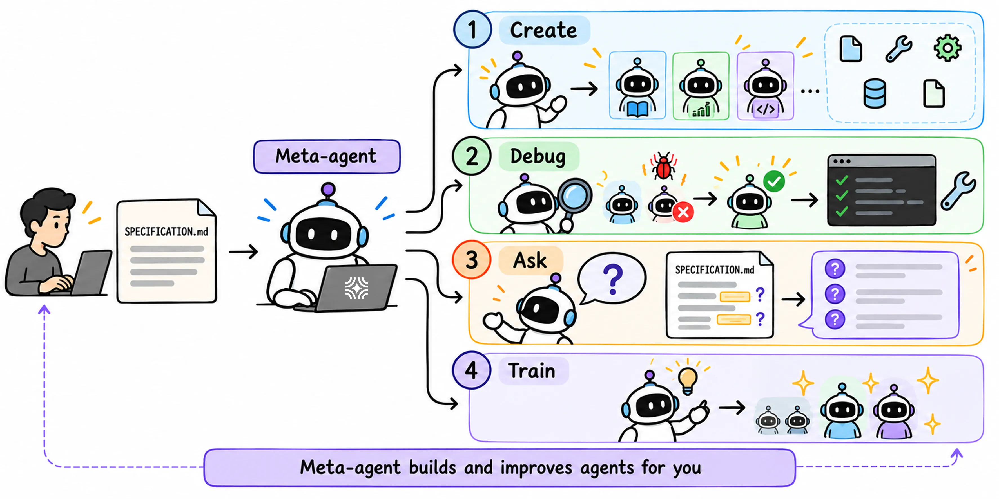

<div align="center"> 
  
  <div>Powered By Zenera</div>
</div>
<br>

<div align="center">


[](https://github.com/andreyryabov/ZeneraNeo/actions/workflows/ci.yml)
[](LICENSE)
[](https://nodejs.org)
[](#packages)

</div>

# ZeneraNeo

**A toolkit for creating specialized, self-improving agent systems from a
specification and the knowledge your work already has.**

ZeneraNeo turns a clear description of a job into an agentic system built for
that job. Give it the documents, policies, API schemas, files and integrations
the work depends on; describe the outcome and its constraints; then let **[the meta-agent](#what-is-the-meta-agent)** design the specialists, tools, skills, memory, handoffs, retrieval
and execution strategy that fit.

## What is it for?

ZeneraNeo is for recurring work that needs more than one general-purpose chat:
technical investigation, policy review, operations triage, software delivery,
analysis, and workflows that must show their evidence. The result is a project
you can run, inspect, improve, review and share.

> **This is an open-source side project for experimentation and chore work.**
> It is **not** the official Zenera AI Platform, and it carries no support or
> stability promises.

## Getting started

### 1. Install

> You need [Node.js](https://nodejs.org) 24+ and [Podman](https://podman.io) (agents run commands in a container).

Install the packages:

```sh
npm i -g @zenera/cli @zenera/neo @zenera/rag @zenera/faker
```

### 2. Add a model key and pick the meta-agent model

```sh
zen key add openai
zen meta model --pick
```

### 3. Create and open a project

```sh
zen init my-project
zen open my-project
```

`zen open my-project` opens the project in your default editor.

### 4. Describe the system

Start editing `SPECIFICATION.md`.

`SPECIFICATION.md` is the file where most of the work on your project happens.
Use it to describe the purpose of the project, its models, its agents, and
other details. It is free-form: you can describe the agents in your own words,
and the meta-agent turns that description into the actual system.

`SPECIFICATION.md` may include, but is not limited to, these items:

- **Purpose** - what the project is for.
- **Models** - the chat and embedding models the project uses.
- **Setup** - what must be done before the first run, such as downloading data
  and building indexes.
- **Agents** - what each agent does, its rules and its tools.
- **Knowledge** - existing, read-only materials the agents can read, such as
  documentation indexes and API schemas.
- **Memory** - what the agents should remember between runs, and when to look
  in memory first.

> **❓ Why are different models configured?**
>
> **Because both are needed:**
>
> - **The meta-agent model** (`zen meta model --pick`) is used by `zen meta` to
>   _build_ the project. It writes the agents, scripts and configuration, so
>   choose a strong reasoning model. It is set once per machine and is not part
>   of the project.
> - **The project models** (the `## Models` section of `SPECIFICATION.md`) are
>   used by the generated agents when they _run_. They are stored in the project
>   (`agents.yaml`), so anyone who clones it runs the same system. They include
>   an embedding model for indexes and memory. A chat model cannot be used for
>   embeddings, and changing the embedding model requires re-indexing.

See a complete example in
[`SPECIFICATION.md`](examples/projects/01-docs-rag/SPECIFICATION.md) of
example 01.

> Worked examples available now:
>
> - [01 - Documentation RAG](examples/projects/01-docs-rag/README.md): answers
>   questions about the Hugging Face Transformers documentation from an index
>   built out of it.
> - [02 - API Integration](examples/projects/02-api-integration/README.md):
>   finds a meeting request in a mock mailbox, checks mock calendar availability
>   and, after you confirm, creates an event and sends a confirmation.

### 5. Generate the system

Once `SPECIFICATION.md` is filled in, run this in the CLI:

```sh
zen meta run my-project /spec-sync-project
```

It generates and updates the system.

### 6. Clarify the specification with the meta-agent

Check whether `SPECIFICATION-FEEDBACK.md` exists.

**The meta-agent does not guess: if something is unclear, it asks.**

- `SPECIFICATION-FEEDBACK.md` is a questionnaire.
- Every question carries two to four written-out answers, each with a `[ ]` box.
- Put an `x` in the box of the answer you want, delete the ones you do not, or
  write your own in their place. Any of these counts as an answer.
- Apply the feedback:

```sh
zen meta run my-project /spec-apply-feedback
```

### 7. Check and run

> Enter the project directory:
>
> ```sh
> cd my-project
> ```

- `zen check` to verify that the project loads and the models answer.
- `zen run my-project "your question"` to run it. Without a question it opens
  an interactive terminal app.

### 8. Inspect the results

- `zen inspect` to open the report of the last run: its trajectory and
  improvement opportunities.

> When you are standing inside a project, the project name is optional: a bare
> `zen run`, `zen check` or `zen inspect` means the project you are in.

## What is the meta-agent?

The meta-agent is the agent that builds your system. It is part of the `@zenera/cli` (`zen meta run`) and works on your project as a developer would:

- reads `SPECIFICATION.md` and generates the project from it: agents, prompts, tools, skills, memory rules and setup scripts;
- runs the setup (for example, builds the search indexes) and checks that the
  result works;
- asks questions in `SPECIFICATION-FEEDBACK.md` when the specification is
  unclear, instead of guessing;
- reads the trajectories of your runs and proposes improvements to the
  specification.



You describe the job in `SPECIFICATION.md`; the meta-agent writes the system.
The agents it creates are the ones you later run with `zen run`.

## Our principles - autonomous specialization and improvement

People define the job; they should not have to hand-design every agent, prompt,
handoff, tool, memory rule and evaluation loop required to do it well.
`SPECIFICATION.md` is the source of intent: the work to perform, the knowledge
to use, the boundaries to keep, and the criteria that define success.

ZeneraNeo's meta-agent turns that intent into a working system, then autonomously
tests it, examines its observable trajectory, and proposes improvements to the
specification. The next system is generated from that improved intent. This is a
continuous loop for making a specialized system more effective without losing
the human-defined purpose and constraints.

The loop is deliberate. A run is not only an answer; it is evidence about the
system that produced it. ZeneraNeo records the trajectory, evaluates the result
against the specification, identifies changes that improve quality, accuracy,
latency or token use, and turns those findings into reviewable updates.

Projects are ordinary Markdown and YAML, so the intent, generated system and
proposed changes can be versioned in Git and reviewed like any other software.
Each run leaves an inspectable trajectory of the prompts, agent handoffs, tool
calls, results and usage that produced it. Teams can examine that record
themselves or give it to a meta-agent to evaluate outcomes, diagnose weak steps
and propose the next improvement with evidence.

## What the toolkit creates

- **Specialized agents** with distinct responsibilities, models and execution
  boundaries, instead of one prompt asked to do everything.
- **Teams that coordinate** through explicit handoffs, parallel work and
  strategies matched to the task.
- **Knowledge systems** over documentation and API schemas, with retrieval that
  can discover, inspect and verify evidence.
- **Tools and integrations** selected for the job, with file access, sandboxed
  commands and generated integrations where they are needed.
- **Durable memory** that carries useful context between runs without relying on
  an ever-growing chat transcript.
- **Evaluation and observability** through self-tests, success criteria and
  trajectories that explain what happened, how long it took and what it used.
- **Shareable projects** expressed as Markdown and YAML, ready for source
  control, code review and reuse by another team.

## Packages

| Package                                       | Role                                                                                                                                           |
| --------------------------------------------- | ---------------------------------------------------------------------------------------------------------------------------------------------- |
| [`@zenera/cli`](packages/cli/README.md)       | The `zen` command-line workflow for creating projects, generating agent systems, running them, testing them and inspecting their trajectories. |
| [`@zenera/neo`](packages/neo/README.md)       | The TypeScript runtime for applications that need agents, models, tools, skills, memory, trajectories and project loading directly in code.    |
| [`@zenera/engine`](packages/engine/README.md) | Runs a project the way `zen run` does - keyring, sandbox, sessions, run records - for a server or any other host that is not the CLI.          |
| [`@zenera/rag`](packages/rag/README.md)       | Advanced retrieval for agent knowledge: semantic, full-text and hybrid search over documents, plus graph-aware API schema indexing and search. |
| [`@zenera/faker`](packages/faker/README.md)   | Mock API generation from OpenAPI and Swagger descriptions, with generated behavior validated against the API contract.                         |

`@zenera/cli` installs `zen`; `@zenera/rag` and `@zenera/faker` extend it with
their own subcommands. Install only the capabilities a project needs.

## Learn more

- [Specification-driven projects](docs/specification.md)
- [Agent configuration](docs/agents-yaml.md)
- [Projects and sharing](docs/projects.md)
- [Agent knowledge and document retrieval](docs/knowledge.md)
- [API integrations](docs/integrations.md)
- [Memory](docs/memory.md)
- [Fine-tuning and writing rubrics](docs/finetuning.md)
- [Every model through a Bifrost gateway](docs/gateway.md)

Early days and moving fast - issues, questions and pull requests are welcome.
[MIT](LICENSE).
