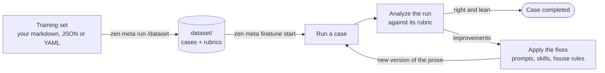
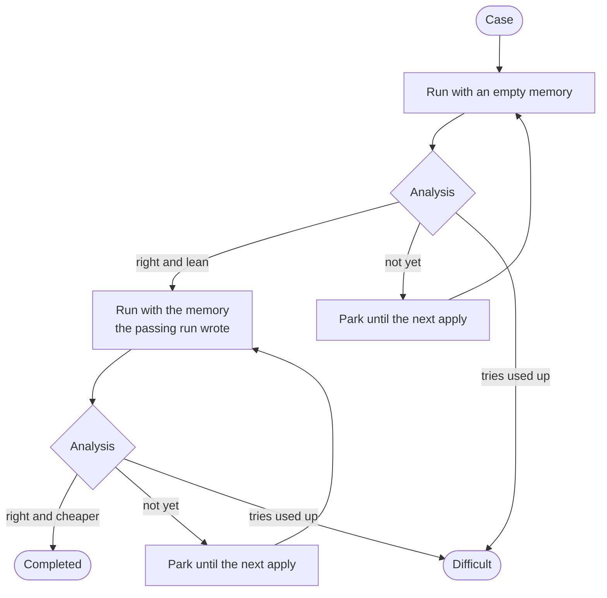

# Fine-tuning a project on its dataset

A project that loads and answers is not yet a good one. The first version
usually spends too many model calls, finds the same things again on every run,
does in sequence what could run in parallel, and misreads parts of the domain.
Fine-tuning fixes that by running real requests, reading what the agents did,
and rewriting the project's prose until the runs are right and short.

**Nothing here changes model weights.** What is tuned is the text the model is
given: the agent prompts, the skills, the house rules under `agents/`, and the
memory the agents write. The model stays the same. Everything it is told
changes.

Fine-tuning takes two things:

1. **A dataset** - real requests, each with a **rubric** that says what a right
   run does. `zen meta dataset` keeps it in `dataset/`.
2. **The loop** - `zen meta finetune` runs every case, analyzes the run against
   its rubric, applies the fixes the analyses ask for, and runs the case again.



## 1. Write the training set

A training set is a file the project holds - markdown, JSON or YAML - with one
section per request. It has no fixed format: a model reads it and writes the
cases out. What it needs from you is that every case is its own section, so a
change to one case can be found without reading the others.

A markdown training set, `training/cases.md`:

```markdown
# Training set

These are requests the assistant must handle. One per section.

## Planning

### Query: organize my day

> organize my day

#### Rubric

- calls the calendar for today's events
- calls the mailbox for unread threads
- makes the calendar and mailbox calls in parallel
- does not ask for anything it can fetch
- answers with a time-ordered plan, not two lists
- names every pair of meetings that overlap

#### Expected

A time-ordered plan for the day that names the two overlapping meetings.

### Query: move my 3pm to tomorrow

> move my 3pm to tomorrow

#### Rubric

- finds the 3pm event before changing anything
- says which event it moved and to when

## Search

### Query: what did finance send me last week

> what did finance send me last week


#### Rubric

- searches mail by sender and date, not by reading every thread
- lists each message with its subject and date
```

Then tell the project where it is. Either name it in `SPECIFICATION.md` - a
line under the section that says what _done_ means is enough - or name it to
the command when you build the dataset.

What each part of a section becomes:

| In the source                      | In the case                                                         |
| ---------------------------------- | ------------------------------------------------------------------- |
| The quoted request                 | `input` - exactly what the agent is sent                            |
| An image, audio, video or PDF link | a media part of `input`                                             |
| The bullets under **Rubric**       | `rubric` - **verbatim**, one line per bullet, ids `r1`, `r2`, ...   |
| The text under **Expected**        | `expected` - context for grading, never compared word for word      |
| Context before the request         | `notes` - unless the agent is meant to see it, then it is the input |
| The section heading it sits under  | `class` - a distinction the source already makes                    |
| A request with no rubric           | a case with no rubric, graded on grounding (see below)              |

## 2. Write the rubric

The rubric is the test. Everything the loop does is aimed at making rubric
lines pass, so a rubric that tests the wrong thing tunes the project toward the
wrong thing.

### What a rubric line is checked against

A run is never re-solved. The analysis reads the run's **trajectory** - every
model call, tool call, fork, memory operation and result, recorded as a graph -
and grades each rubric line from it alone:

| Grade     | When                                                                                  |
| --------- | ------------------------------------------------------------------------------------- |
| `pass`    | the trajectory shows it                                                               |
| `fail`    | the trajectory shows the opposite, **or shows nothing either way**                    |
| `invalid` | the line itself is broken: it names one way of doing it, or no run could ever show it |

Two consequences shape how lines are written:

- **A line about a call passes by the call, not by the answer.** "Calls the
  mailbox" passes when the graph has that call with sensible arguments. A final
  answer that says "I checked your mail" proves nothing.
- **Silence is a fail.** A line the run gives no evidence for is graded `fail`.
  So every line must be about something that leaves a trace: a call, an order
  of calls, a fork, something in the answer.

### Grade the path as well as the answer

A rubric that only checks the answer lets a run take any number of calls to
reach it. Lines about the path are what turn "right" into "right and short":

| Kind of line   | Example                                                       |
| -------------- | ------------------------------------------------------------- |
| a call made    | calls the calendar for today's events                         |
| a call avoided | searches mail by sender and date, not by reading every thread |
| an order       | finds the 3pm event before changing anything                  |
| parallelism    | makes the calendar and mailbox calls in parallel              |
| no question    | does not ask for anything it can fetch                        |
| the answer     | answers with a time-ordered plan, not two lists               |
| a detail       | names every pair of meetings that overlap                     |
| an honest no   | says the request cannot be done when no such event exists     |

Cost beyond the rubric - calls, tokens, time, repeated work - is graded by the
analysis on every run anyway. A rubric line is for what must hold, not for a
number to beat.

### Lines that work, and lines that do not

| Line                                                             | Verdict                                                                            |
| ---------------------------------------------------------------- | ---------------------------------------------------------------------------------- |
| calls the mailbox for unread threads                             | good - a call the graph either has or not                                          |
| sorts the events on the server, not after fetching               | good - behaviour, visible in whichever tool or language the run used               |
| names every pair of meetings that overlap                        | good, **if the data under the run is fixed** - a mock API or a frozen document set |
| uses pandas to group the events                                  | `invalid` - names one implementation; a right run in plain Python fails it         |
| writes a helper called `merge_events`                            | `invalid` - a name is an implementation detail                                     |
| gives a good answer                                              | ambiguous - reported as a specification problem; says nothing a grader can check   |
| calls the calendar and the mail in parallel and sorts the result | split it - one line gets one grade, so two checks in a line hide which one failed  |

Rules of thumb:

- **One check per line.** Each line gets one grade. A line holding two checks
  fails as a whole and hides which half broke.
- **Say what is right, not how one solution did it.** A language, a library, a
  variable or helper name, a file layout - each is graded `invalid`.
- **Name values only when the data cannot move.** "Names the 10:00 standup"
  holds against a mock calendar and fails at random against a live one.
- **Write it so it can fail.** "Handles the request well" never fails, so it
  never steers anything.

### With no rubric

A case may have no rubric. Its standard is then **grounding**: the run answered
what was asked, and every specific claim in its answer - a name, an id, a
number, a path, an endpoint - appears in a tool result of the run. A claim with
no source is a hallucination, and the run is wrong. `expected`, when present,
is compared with the answer for sense, never word for word.

Grounding catches made-up answers; it cannot catch a run that took the long way
round to a true one. Give a rubric to every case whose path matters.

### Rubrics stay out of the runs

The agent never sees a rubric. A rubric in a prompt, a skill, a batch input or
a file in the workspace turns the test into the answer. Rubrics leave
`dataset/` only through `zen meta dataset show`, `sample --format cases` and
`export`, for a grader.

## 3. Build the dataset

```sh
zen meta run /dataset                      # every source SPECIFICATION.md names
zen meta run /dataset training/cases.md    # add one source
zen meta run /dataset rebuild              # read every source again
```

`/dataset` is a prompt for the meta agent. It reads each section, writes the
cases out by the rules of the `zen-dataset` skill, checks the change with a dry
run, and applies it. It never edits a source, never edits `agents/`, and never
runs a case. The same prompt is the `/dataset` chat command in the project's
editor.

The result is committed with the project:

```
dataset/
    manifest.json      revision, a hash per source file, the sections ignored
    revisions.jsonl    one line per revision: added, updated, retired, restarted
    cases/<id>.json    each case as it is now
    log/<id>.jsonl     each case's history: every change, every note, who made it
```

A case:

```json
{
    "id": "planning-organize-day",
    "rev": 3,
    "status": "active",
    "class": "planning",
    "complexity": "complex",
    "tags": ["calendar", "mail"],
    "input": "organize my day",
    "rubric": [
        { "id": "r1", "text": "calls the calendar for today's events" },
        { "id": "r2", "text": "calls the mailbox for unread threads" },
        { "id": "r3", "text": "makes the calendar and mailbox calls in parallel" }
    ],
    "expected": "A time-ordered plan for the day that names the two overlapping meetings.",
    "source": {
        "file": "training/cases.md",
        "anchor": { "heading": ["Planning", "Query: organize my day"] }
    }
}
```

- **`id`** is stable: a case read again from the same section keeps it, so its
  history and results stay attached. Letters, digits, `.`, `-` and `_`.
- **`complexity`** rates the work the request demands, not the sentence:
  `simple` is one call or none, `medium` is several dependent calls or one
  delegation, `complex` is fan-out, several agents, or a plan that can go wrong.
- **`tags`** are free words for what cuts across classes - `mail`,
  `pagination`, `impossible`.
- **`input`** is a string, or a list of parts - text, and
  `{ "image" | "audio" | "video" | "file": "<path or url>" }`.
- **`anchor`** names the section the case came from - a heading path in
  markdown, a JSON pointer in JSON or YAML - so the command can find that
  section again with no model involved.
- **`rev`** is the dataset revision that last changed the case.
  `zen meta dataset show <id>@<rev>` reads it back as it was, so a run that
  recorded `{id, rev}` is always graded against the rubric it ran under.

Only `zen meta dataset` writes `dataset/`. A hand edit skips the history, the
revision and the lock, and the next drift check will not see it.

## 4. Keep it in step with the source

The training set keeps changing - a request is added, a rubric is reworded. The
dataset follows it a section at a time:

```sh
zen meta dataset            # revision, counts, and what drifted
zen meta dataset drift      # which cases their source sections moved under
zen meta run /dataset       # re-read only those sections
```

A source file whose hash is unchanged is not opened. In a file that changed,
each case's own section is compared, so a typo three sections away touches
nothing.

| Drift       | Means                                           | `/dataset` does                                      |
| ----------- | ----------------------------------------------- | ---------------------------------------------------- |
| `changed`   | the case's section differs                      | re-reads it                                          |
| `gone`      | its heading no longer finds exactly one section | retires the case, or re-anchors it if it was renamed |
| `uncovered` | a section no case comes from                    | adds its cases, or ignores it if it holds no request |

**What restarts a case.** A change to `input`, `rubric` or `expected` - the
question, or how it is judged - lists the case as **restarted**: results from
its earlier revision were about a different question. A change to `class`,
`complexity`, `tags`, `notes` or `source` revises the case without restarting
it.

**Nothing is deleted.** A removed case is `retired`: out of every sample and
every tuning, still readable, its id never reused.

### By hand

When the source is not yours to edit, change the case directly and say why:

```sh
zen meta dataset update planning-organize-day \
    --rubric-edit r3="fetches the calendar and the mailbox in parallel" \
    --override --why "the source names a tool this project does not have"
zen meta dataset update search-finance-week --rubric-add "says when nothing was found" --why "…"
zen meta dataset update search-finance-week --rubric-drop r2 --why "…"
zen meta dataset retire planning-move-3pm --why "the feature was removed"
```

`--override` keeps a change through every later re-reading of the source;
without it the next `/dataset` writes the source's version back. A rubric line
keeps its id while it exists, so a note that says `r2 failed` keeps meaning the
same line.

**Never move a rubric to match what an agent did.** That deletes the test. A
rubric changes when what is right changes.

## 5. Try a few cases by hand

Before a whole tuning, it is worth running a handful of cases and reading the
analyses yourself:

```sh
zen meta dataset sample --rubric yes -n 6 --format batch -o .tmp/try/cases.json
zen run batch --input .tmp/try/cases.json    # prints the batch directory
zen meta run /analyze <run dir>              # one case's run, from its output.json
```

`sample` draws a cross-section: classes take turns, cases with a rubric first,
then complex before simple, ties broken by `--seed`. A larger `-n` keeps every
case a smaller one chose. `--format batch` writes only `id` and `input` - never
a rubric.

`/analyze` grades one run against its case - it finds the case by the run's
place in the batch - and leaves the verdict on it:

```sh
zen meta dataset log planning-organize-day     # every change, every verdict
zen meta dataset ls --verdict wrong            # what is still wrong
```

## 6. Run the tuning

```sh
zen meta finetune start -N 4      # 4 cases at a time
zen meta finetune                 # where it stands
zen meta finetune stop            # finish the steps in flight, then stop
```

`start` prints a local address that shows the tuning live in a browser, with
its diagrams drawn. It refuses a dataset that has drifted from its sources: run
`/dataset` first, or pass `--force`.

### What one case goes through



1. **Without memory.** The case runs from an empty memory, and `/analyze`
   grades the run: every rubric line, then the cost - calls, tokens, repeated
   work, a fork that should have happened. It writes a verdict and a list of
   **improvements**, each one a sentence to add, narrow or delete in a named
   file.
2. **Done or parked.** A run is done when it is right, no rubric line fails,
   and nothing left to cut would save at least two model calls or a quarter of
   its tokens. Otherwise the case is **parked**: it gives its worker back and
   waits for the next apply.
3. **With memory.** Once a run passes without memory, the case runs again from
   a copy of the memory that run wrote. Now the question is _cheaper_: does it
   recall before researching, and does recall replace the work?
4. **Difficult.** A case whose tries run out (`--tries`, `--mem-tries`) is
   difficult. So is one at once when all an apply could say of it is
   structural - a missing tool, a skill binding, the dataset itself.

### Applies

Parked cases' improvements are applied together by the apply agent, once **M**
cases are parked or nothing else can run. One case is an anecdote: a new rule
needs two cases asking for it. With one, an apply may only edit, move or delete
without growing the prose; anything more waits until a second case asks.

Every apply is a new version of `agents.yaml` and `agents/`, and passes two
gates or is undone:

- **`zen check`** must pass.
- **The budget** must hold. Every model call reads the house rules, its prompt,
  its preloaded skills and one line per skill, so that is what is counted. One
  apply may add at most `--budget` bytes to it, and nothing once it is
  `--max-growth` percent over where the tuning began. Moving a procedure out of
  a prompt into a skill is a saving: a skill body is paid for only when loaded.

After an apply, `--recheck` cases that already passed run again on the new
prose. One that fails twice has regressed: its findings go to the next apply,
which repairs what broke.

### Options

| Flag               | Default | Means                                                       |
| ------------------ | ------- | ----------------------------------------------------------- |
| `-N`, `--workers`  | 4       | cases trained at once                                       |
| `-M`, `--apply-at` | 4       | apply once this many cases are parked (at least 2)          |
| `--tries`          | 4       | tries without memory before a case is difficult             |
| `--mem-tries`      | 3       | tries with memory                                           |
| `--budget`         | 1500    | bytes one apply may add to what every call reads            |
| `--max-growth`     | 50      | percent over the start after which an apply may add nothing |
| `--skill-cap`      | 12000   | bytes one skill may hold                                    |
| `--max-skills`     | 10      | skills one agent may see                                    |
| `--recheck`        | 3       | passed cases run again after each apply; 0 for none         |
| `--merge-every`    | 3       | merge the kept memories after this many more arrive         |
| `--class`, `--id`  |         | only these classes, or ids matching a glob                  |
| `--rubric yes\|no` |         | only cases with, or without, a rubric                       |
| `--limit <n>`      |         | only the first n cases of the order, this start only        |
| `--more <n>`       |         | at most n more cases, this start only                       |

Settings are kept in `finetune/loop.json`. `start` again resumes where the last
one stopped: every step's result is on disk, and nothing finished is repeated.

A quick, cheap first look:

```sh
zen meta finetune start --limit 4 --recheck 0
```

## 7. Read the results

```
finetune/
    STATUS.md               the whole tuning - open this first
    cases/<id>/FEEDBACK.md  one case: rubric, latest analysis, decisions, every try
    applies/<NNN>/APPLY.md  one apply: requests, decisions, every file changed, the gates
    memories/merged/mNN/    the passing runs' memories, merged
    systems/                a copy of agents.yaml and agents/ per version
```

`STATUS.md` says whether the tuning is working. Its summary compares each
case's first try without memory with its passing one - the fixes - and the
passing try without memory with the passing try with it - the memory - in
tokens, calls, tool errors and time, over the same cases.

Three lists in it ask for a person:

- **Rubric problems.** Lines an analysis graded `invalid`, each with how it
  should read. The loop never edits a rubric and no apply sees these; an
  `invalid` line never keeps a case from completing. Fix the training set,
  then run `/dataset`: the case restarts on the corrected rubric.
- **Difficult cases**, each with its reason. `structural: ...` needs a change
  the prose cannot make - a tool, a binding, an index. `specification: ...`
  means the only findings were about the rubric or the specification.
  When the cause is fixed, give them another round:

    ```sh
    zen meta finetune retry --difficult
    zen meta finetune start
    ```

- **Failed cases** - something outside the prose broke: the sandbox, a
  provider, a key. Those cases keep their tries and carry on at the next start. A run whose
  analysis finds the network or a service under it down is `void`: set aside
  and run again, never counted against the prose.

To ask an analysis why it decided what it did:

```sh
zen meta finetune session planning-organize-day
```

prints the command that resumes the analyze session of that case's latest try.

## Reference

- `zen meta dataset --help` and `zen meta finetune --help` - every verb and flag.
- The `zen-dataset` skill in a project's `.github/skills/` - extraction rules,
  anchors, drift, notes and sampling in full.
- [The `zen meta finetune` reference](../packages/cli/templates/editor/.github/skills/zen-cli/references/finetune.md)
  and [the `zen meta dataset` reference](../packages/cli/templates/editor/.github/skills/zen-cli/references/dataset.md).
- [Specialized agents](specialized-agents.md) - why tuning the prose beats
  tuning the model.
- [Memory](memory.md) - what the with-memory runs are tuning.
