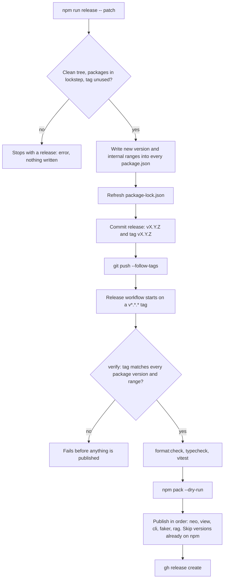

# Release flow

From `npm run release` to a published package. Based on `scripts/release.mjs`, `.github/workflows/release.yml` and `RELEASE.md`.



## Three ways it can fail

### 1. The tag does not match the tree (reproduced locally)

```
$ node scripts/release.mjs verify v9.9.9
release: tag v9.9.9 does not match @zenera/neo@1.1.28
exit=1
```

In CI the step "The tag must match the versions in the tree" goes red and every later step is skipped. Nothing reaches npm.

### 2. Two tags are pushed together (from RELEASE.md and a workflow comment, not reproduced)

Two workflow runs race to write the same packument. The registry answers `409 Failed to save packument` and the release is left half published. The workflow now has a `concurrency: release` group. To finish, re-run the workflow with the same tag; the publish step skips what is already on npm.

### 3. A new package has never been published (from RELEASE.md, not reproduced)

CI fails at that package's turn with `npm error code ENEEDAUTH`, after the packages before it have published. Its first version has to be published by hand, then a trusted publisher added on npmjs.com.
