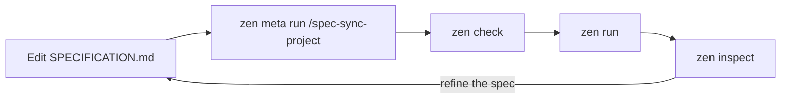

<div align="center"> 
  
  <div>Powered By Zenera</div>
</div>
<br>

<div align="center">
  

[](https://www.npmjs.com/package/@zenera/cli)
[](https://github.com/andreyryabov/ZeneraNeo/blob/main/LICENSE)
[](https://nodejs.org)
[](https://github.com/andreyryabov/ZeneraNeo/actions/workflows/ci.yml)

[Install](#install) · [Quickstart](#quickstart) · [How it works](#how-it-works) · [Self-improving loop](#the-self-improving-loop) · [Fine-tuning](#evaluate-and-fine-tune) · [Reference](#reference) · [Docs](#documentation)

</div>

# @zenera/cli

**`zen`: build specialist agents, share them, and run them from the command line.**

`@zenera/cli` is the command-line package of the
[ZeneraNeo](https://github.com/andreyryabov/ZeneraNeo) toolkit. You describe the
work in a specification; a **meta-agent** designs the multi-agent system that
does it; a **self-improving loop** of runs, traces, evals and fine-tuning makes
that system better over time.

> Part of [ZeneraNeo](https://github.com/andreyryabov/ZeneraNeo). This is an
> open-source side project for experimentation and chore work - **not** the
> official Zenera AI Platform. It carries no support or stability promises.

<details>
<summary><strong>Contents</strong></summary>

- [What it is](#what-it-is)
- [What you build](#what-you-build)
- [Why it is different](#why-it-is-different)
- [Install](#install)
- [Quickstart](#quickstart)
- [Concepts](#concepts)
- [How it works](#how-it-works)
    - [The specification and the meta agent](#the-specification-and-the-meta-agent)
    - [A worked example](#a-worked-example)
    - [Anatomy of a project](#anatomy-of-a-project)
- [The self-improving loop](#the-self-improving-loop)
- [Evaluate and fine-tune](#evaluate-and-fine-tune)
- [Share a project](#share-a-project)
- [Reference](#reference)
    - [Commands](#commands)
    - [Conventions and exit codes](#conventions-and-exit-codes)
    - [The meta agent](#the-meta-agent)
    - [Models and credentials](#models-and-credentials)
    - [Sandbox](#sandbox)
    - [Cache](#cache)
- [Ecosystem](#ecosystem)
- [Documentation](#documentation)
- [License](#license)

</details>

## What it is

Not one general assistant that is passable at everything, but a team built for
the work you keep doing, under a name you can type:

```sh
zen run accountant "Q3 - match the receipts drawer to the ledger, then update the return"
zen run accountant "this MSA against our playbook - redlines, and what I must not sign"
zen run analyst    "why churn doubled in the EU accounts - the exports are in this folder"
zen run analyst    "what changed in EU battery regulation this year, with sources"
zen run devops     "this week's advisories - which of them actually reach our code"
zen run devops     "the 03:12 outage - timeline, contributing factors, owners"
```

Three agents, six requests. An agent you have built is not a one-job script; it
is a specialist you keep coming back to, for work that returns every quarter,
every sprint, every deal.

Once built, the agent is a command. It works on the files in your current
directory, runs real commands in a container, searches the web when it needs
to, and records every token it spends.

Getting there takes three steps:

1. **Describe it.** Write `SPECIFICATION.md`: what the system is for, which
   specialists it needs, what each may use, and what _done_ means.
2. **Test it.** `zen check` validates the project, `zen run` exercises it,
   `zen inspect` shows what it actually did. When the result is wrong, fix the
   specification, not the prompts, and go round again.
3. **Share it.** A project is a folder: commit it, review it in a pull request,
   send it. On the other end, one `zen init <dir>` registers it and it becomes
   their command too.

## What you build

Half a page of specification becomes a system like one of these. None of them
ship with the CLI; each is a folder someone wrote and could send you.

| Project        | The team inside it                                                                                                                                                                                                                                                                                                          |
| :------------- | :-------------------------------------------------------------------------------------------------------------------------------------------------------------------------------------------------------------------------------------------------------------------------------------------------------------------------- |
| **accountant** | A **bookkeeper** reads and classifies every receipt, statement, invoice and agreement in the folder. A **reconciler** matches each against a ledger line or playbook position and lists what has no pair. A **preparer** fills the return or drafts the redlines. A **checker** rejects anything no document substantiates. |
| **analyst**    | A **planner** splits the question into branches. **Researchers** work in parallel over your files and the web. A **statistician** writes and runs Python in the sandbox. An **editor** joins it into one answer where every claim carries its source.                                                                       |
| **devops**     | A **gatherer** pulls advisories, logs, alerts and deploys into one picture. A **tracer** works out whether a vulnerable path is reachable, or which change broke production. An **engineer** plans the fix, applies it step by step, and stops the moment a check fails.                                                    |

A committed project runs the same on anyone's machine, on whichever models they
prefer, without carrying your keys.

## Why it is different

Most tools give you one agent, or a framework and an empty file. `zen` is a
factory: it designs the system for you, then keeps it honest.

- **A meta-agent designs the system.** You state the problem; it derives the
  specialists, prompts, tool grants, hand-offs and fan-out from what you wrote,
  and validates them before anything runs.
- **Self-improvement, not a one-off build.** Build, run, read the record, fix
  what was wrong, run again, and the meta-agent can drive that loop itself.
  Failures come back as findings with a cause and a fix.
- **Agent fine-tuning on datasets and rubrics.** Cases built from your
  specification are run, scored, analyzed and re-run until the system is both
  correct and lean. It tunes prompts, skills and memory, not model weights.
- **Built-in observability.** Every run is recorded against the architecture it
  declared: the agent nobody called, the skill that never fired, where the
  tokens went. Nothing to instrument, nothing to sign up for.
- **Your knowledge, searchable.** Hybrid retrieval over your documents and API
  descriptions, plus a graph memory, so what an agent learned in March is still
  there in September.
- **Integrations it writes itself.** No MCP server to find, no connector to wait
  for. To reach your ERP, your database or a twenty-year-old SOAP endpoint, it
  writes the call and runs it in a sandbox.
- **Customisable all the way down.** Stay in the specification, tune a single
  agent's model, tools and memory, or drive the kernel turn by turn. No layer is
  sealed.

## Install

Requires Node.js 24+. The OpenAI, Anthropic, Google and OpenRouter SDKs ship
with the CLI, so any of those providers works out of the box.

```sh
npm i -g @zenera/cli
```

Or try it without installing:

```sh
npx @zenera/cli --help
```

The binary is installed under three names: `zen`, `zn` and `zenera`.

<details>
<summary><strong>Tab completion</strong> (zsh, bash, fish)</summary>

A global npm install sets up completion for commands, projects and stored
prompts automatically. It appends a guarded loader to your current shell's
startup file, once. **Open a new terminal** to activate it; the installer
cannot update the terminal where you ran npm.

Setup respects `ZDOTDIR` for zsh and `XDG_CONFIG_HOME` for fish. For Bash on
macOS it covers both login shells (the active `.bash_profile`, `.bash_login` or
`.profile`) and non-login shells (`.bashrc`). The loader does nothing once `zen`
is uninstalled.

Automatic setup is skipped for local installs and `npx`, under root/sudo, in
CI, on Windows, when `$SHELL` is missing or unsupported, and with
`--ignore-scripts`. To set it up by hand, or for another shell:

```sh
zen completion --install            # the shell you are in; --yes to skip the question
zen completion fish --install       # or name one
```

Or add `eval "$(zen completion zsh)"` to `~/.zshrc` yourself.

</details>

## Quickstart

From nothing to a working agent system:

```sh
npm i -g @zenera/cli         # every vendor SDK comes with it
zen key add openai           # prompts for the key without echoing it; stored in ~/.zenera
zen init my-project          # scaffolds a project and registers it
zen open my-project          # opens it in your editor
```

Describe the job in `SPECIFICATION.md`, then let the meta agent build the
system from it:

```sh
zen meta run my-project /spec-sync-project
```

Validate the result and run it against a real directory:

```sh
zen check my-project
cd ~/code/some-repo
zen run my-project "summarise this repo and write NOTES.md"
zen inspect                  # open the run's report.html
```

Day to day:

```sh
zen run my-project              # no prompt: opens a full-screen terminal app (TUI)
zen list --sessions             # every project, its sessions and last run
zen list --runs                 # the most recent runs across every project
echo "triage this" | zen run my-project --json | jq
```

Inside a project folder the name is optional: a bare `zen run`, `zen check` or
`zen inspect` means the project you are in.

A prompt on the command line skips every question: it starts a fresh session
and uses the current directory as the workspace, with write access.
`--session`, `--workspace` and `--read-only` override that.

## Concepts

- **Project**: a named directory holding a complete agent definition and the
  sessions run against it. `agents.yaml` is what makes a directory a project,
  so moving or cloning it loses nothing.
- **Specification**: `SPECIFICATION.md`, the description of what the project is
  for. Every other file implements it, and where they disagree it wins.
- **Meta agent**: a coding agent that works _on_ the project, keeping its files
  in line with the specification and improving them from evidence.
- **Session**: a context that persists across runs: one workspace, one memory,
  one store for large files, and a full record of what happened. Resumable.
- **Run**: one prompt in, one answer out, inside a session. Recorded in full,
  whether or not you were watching.
- **Workspace**: the directory the agents may read and write. A command-line
  prompt uses the current directory; the TUI offers the session's own empty
  folder and asks before using anything outside it.
- **Keyring**: `~/.zenera/neo`, readable only by you. See
  [Models and credentials](#models-and-credentials).
- **Cache**: `~/.zenera/neo/cache`, shared by every project on the machine and
  never emptied by anything but you. See [Cache](#cache).

## How it works

### The specification and the meta agent

`zen init` writes `SPECIFICATION.md` first, and everything else in the folder
implements it. A change to what the system does therefore starts in the
specification, not in `agents.yaml`.

The scaffolded specification is not a list of headings. It accurately describes
the project just created, so you can read it alongside the files before
changing a word:

```markdown
## Agents

One agent, `default`, which is the entry point and the whole system. It has
nobody to hand work to, because there is no second job to hand on.

## Done means

- The change asked for is in the workspace, or the question is answered from
  what is actually in it.
- Everything the agent claims a command did, that command actually did - it was
  run, and its output was read.
- The reply names what changed, file by file, and says what it deliberately did
  not do.
```

The editing cycle is four steps, each a single command:

1. **Edit `SPECIFICATION.md`** (`zen open` launches your editor): what the
   system is for, which agents exist, what each may use, what _done_ means.
2. **Run `zen meta run /spec-sync-project`.** It compares the specification
   with every file that implements it, in both directions, and makes the
   smallest change that closes each gap.
3. **Answer `SPECIFICATION-FEEDBACK.md`.** For anything it could not do
   without guessing, it asks a question with two to four written-out answers.
   Tick one, delete the rest, or write your own.
4. **Run `zen meta run /spec-apply-feedback`.** It folds your answers into
   `SPECIFICATION.md` (never into a prompt), then syncs again.

Then `zen check`, then `zen run`. Full guide:
[docs/specification.md](https://github.com/andreyryabov/ZeneraNeo/blob/main/docs/specification.md).

<details>
<summary>The prompts <code>zen init</code> installs</summary>

Prompt files live under `.github/prompts/`; `zen meta run /<name>` runs one and
`zen meta prompts` lists them. `zen init` and `zen open` rewrite them each time,
so they never go stale, and local edits to them do not survive.

| Prompt                 | Does                                                             |
| :--------------------- | :--------------------------------------------------------------- |
| `/spec-sync-project`   | Makes every file match `SPECIFICATION.md`, both directions.      |
| `/spec-apply-feedback` | Folds your answers in `SPECIFICATION-FEEDBACK.md` into the spec. |
| `/project-review`      | Reviews the project as a human reviewer would, and reports.      |
| `/analyze [run]`       | Analyzes one run and says which instruction to change.           |
| `/dataset`             | Builds or refreshes the evaluation dataset from the spec.        |
| `/new-agent`           | Adds an agent: prompt, wiring and hand-offs.                     |
| `/new-skill`           | Adds a skill under `agents/skills/`.                             |

Alongside them, `.github/copilot-instructions.md` explains this runtime to
whatever coding agent opens the folder, and `.github/skills/zen-cli/` is the
CLI's own reference for it.

</details>

### A worked example

A few sentences of `SPECIFICATION.md` become a working two-agent system, with no
hand-written wiring:

```sh
zen init repo-notes && cd repo-notes
zen open                                   # describe a `reader` and a `writer` agent
zen meta run /spec-sync-project            # writes agents.yaml and both prompts
zen check
zen run repo-notes "summarise this repo"   # now a command, usable from any directory
```

The full walkthrough, with the specification, the generated `agents.yaml` and
prompts, is in
[docs/specification.md](https://github.com/andreyryabov/ZeneraNeo/blob/main/docs/specification.md#a-worked-example).
For complete projects, see
[examples/projects](https://github.com/andreyryabov/ZeneraNeo/tree/main/examples/projects);
for what each `agents.yaml` key means, see
[docs/agents-yaml.md](https://github.com/andreyryabov/ZeneraNeo/blob/main/docs/agents-yaml.md).

### Anatomy of a project

Prompts, agent wiring, skills and tool selections are files (Markdown and YAML),
not code buried in an application. Model credentials live in `$HOME`, never in
the project, so there is no secret to strip before sharing.

```
my-project/
    SPECIFICATION.md   what this is for - the intent
    agents.yaml        who exists, what they may use
    agents/            house rules, one prompt per agent, skills
    assets/ dataset/ finetune/ sandbox/ scripts/
    sessions/          what happened when it ran
```

Everything above `sessions/` is the system; everything below it is what happened
when it ran. Nothing is tied to the machine it was written on: agentic systems
become shareable the way repositories are.

The full file-by-file layout, including `.github/`, `.spec-sync/` and `.env`, is
in
[docs/projects.md](https://github.com/andreyryabov/ZeneraNeo/blob/main/docs/projects.md#layout).

## The self-improving loop



Every step is a command, and everything each step reads or writes is a plain
file. That means the loop does not need you in it: the meta agent can run the
whole cycle on the system it just built.

### Inspect a run

`zen inspect` opens a run's `report.html`: the trace, timing and token
statistics, agent architecture, and memory used.


For a model rather than a person, `zen inspect graph` writes the whole run as
one compact Mermaid flowchart: one line per node, short sequential ids, tool
counts in a header. It is small enough to read whole, so the meta agent can
find the failing loop or branch and then open just the nodes that explain it:

```sh
DIR=$(zen run my-project "fix the tests" --json | jq -r .run.dir)
zen inspect graph --dir "$DIR"                          # the shape of the run
zen inspect node n14..n20 --dir "$DIR"                  # those nodes in full
zen inspect ask n17 "why python -c here?" --dir "$DIR"  # ask the model itself
```

### Ask the model why

`zen inspect ask` replays one recorded call (its system prompt, messages and
tool schemas) with your question appended and tool calling off. The model is
told the run is over and that its instructions may be quoted. This is how a
prompt that reads correctly but behaves wrongly explains itself.

- **One-shot:** pass the question on the command line, via `--question-file`,
  or with `--json`. Meant for scripts and the meta agent: stdout carries only
  the answer, then the command exits.
- **Interactive:** omit the question. At a terminal, it walks you through the
  session, run and call, then keeps taking follow-ups until you submit an empty
  one. Without a terminal it errors rather than waiting.

### Let the meta agent close the loop

Because the specification, the `zen check` findings (each with a code, location
and fix) and the run records are all files, you can hand the whole cycle to the
meta agent: test, read the failure, change the sentence in the specification
that caused it, rebuild, run again. "Fix my project" is one instruction. (On
first use, `scripts/_setup.sh` prepares the tool container.)

The rule that keeps this working: **when a run comes out wrong, fix the
specification first, and let the prompt change follow.** Prompts patched
directly drift away from the document that describes them, and a project whose
specification is no longer true has no specification.

## Evaluate and fine-tune

Inspecting single runs finds individual mistakes. To improve a system
systematically, `zen` evaluates it against a dataset and tunes it on the
results. This is **agent fine-tuning**: it optimizes the harness around the
model (prompts, instructions, skills and memory policies), not model weights.

### 1. Build a dataset

```sh
zen meta run /dataset                        # build or refresh dataset/ from its sources
zen meta dataset                             # revision, counts, what drifted
zen meta dataset drift                       # cases whose source sections changed
zen meta dataset sample --rubric yes -n 12 --format batch -o cases.json
zen meta dataset log planning-organize-day   # every change and verdict for one case
```

`dataset/` holds every case with its **rubric**, an anchor to the section it was
derived from, and a journal of changes and findings. Only `zen meta dataset`
writes it. `/dataset` re-reads just the sections that changed, and a case whose
question or rubric changed is marked as restarted. See the `zen-dataset` skill
under `.github/skills/`.

### 2. Run it in batch

```sh
zen run batch --input cases.json   # a file of questions, 16 at a time
```

One project, many questions, each in its own session, workspace and memory
under a batch directory. Answers are written as they arrive, and a failure is
recorded as data rather than stopping the batch. While it runs,
`<batch-dir>/README.md` is a live dashboard, rewritten every second: what each
item is doing, what finished items cost (per model, since agents may use
different ones), and what is still queued.

Memory is isolated by default: each item gets a copy, and
`zen memory merge <batch-dir>/*/memory` folds what they learned back in.
`--memory-read-only` instead lets every item recall from one shared graph,
which is safe because nothing is written.

### 3. Fine-tune on it

```sh
zen meta finetune start -N 4                 # 4 cases at a time; resumes if stopped
zen meta finetune                            # current status
zen meta finetune stop                       # finish steps in flight, then stop
zen meta finetune serve                      # browse the status pages while stopped
zen meta finetune session plan-day           # resume one case's analysis session
```

For each case, the tuner:

1. runs it **without memory** and analyzes the trace until the answer is
   correct and lean;
2. runs it **with the memory it wrote** until that run is cheaper (a memory
   ablation that checks stored knowledge actually helps);
3. collects improvement requests and applies them **in batches** between runs,
   each apply producing a new, diffable version of the prose.

Progress is in `finetune/STATUS.md`, whose summary shows whether the fixes and
the memory are making runs cheaper. Each case has its own
`finetune/cases/<id>/FEEDBACK.md` with the latest analysis and the metrics of
every attempt. `start` prints a local address that shows these pages in a
browser, with diagrams rendered and updated live.

The full method, including how to write rubrics that tune the right thing:
[docs/finetuning.md](https://github.com/andreyryabov/ZeneraNeo/blob/main/docs/finetuning.md).

## Share a project

A project is a directory, but part of that directory belongs to your machine.
`zen export` packs only the part that belongs to the project.

```sh
zen export                            # ./<project>-<stamp>.zip, from inside the project
zen export my-project --out /tmp/a.zip
zen export --no-vectors               # much smaller; needs a restore step on arrival

zen import a.zip                      # unpacks into ./<project> and registers it
zen import a.zip ~/code/theirs --name theirs
```

**Included:** `agents.yaml`, `agents/`, the specification and its feedback,
`assets/`, `memory/`, `sandbox/`, `scripts/` and editor files.
**Left out:** `sessions/`, `.tmp/`, `.git/`, `node_modules/`, lock files, any
top-level `*.zip`, and `.env`.

`.env` **values** never travel, and no flag changes that. The names do, as a
`.env.example` with blank values, because which credentials a project needs is
the first thing the recipient wants to know.

Vectors travel by default. A RAG index without its `lance/` tree looks built but
cannot search, and memory without vectors falls back to term overlap.
`--no-vectors` produces a much smaller archive; the import then tells you to run
`zen rag <subject> restore`.

**Import is safe by design.** The archive is treated as untrusted: every path is
checked against escaping the target directory, symbolic links are refused, and
the unpacked size is bounded. **Nothing inside is executed**, not
`scripts/_setup.sh`, not the Dockerfile, not the `.github/` tree. The next
commands are printed for you to read and run yourself.

## Reference

### Commands

| Stage        | Command      | Does                                                                     |
| :----------- | :----------- | :----------------------------------------------------------------------- |
| **Set up**   | `key`        | The credential keyring: add, check, switch, remove.                      |
|              | `models`     | What this machine can use: list, search, test, pick.                     |
|              | `completion` | Tab completion for zsh, bash and fish.                                   |
| **Build**    | `init`       | Creates a project here or in `<dir>`, and registers it.                  |
|              | `open`       | Opens a project in your editor.                                          |
|              | `meta`       | Runs the meta agent over the project; includes `dataset` and `finetune`. |
|              | `check`      | Validates the project and every file it names, and pings the models.     |
| **Run**      | `run`        | Runs the project: the TUI at a terminal, a single answer otherwise.      |
|              | `sandbox`    | Checks and prepares the container command-line tools run in.             |
| **Inspect**  | `inspect`    | Opens or rebuilds a run's report, graph and nodes; `ask` queries a call. |
|              | `memory`     | What the agents remember: size, listing, one node, or a whole page.      |
|              | `view`       | Shows a folder in the browser, redrawn live as files change.             |
| **Share**    | `export`     | Writes the project to a shareable zip archive.                           |
|              | `import`     | Unpacks one and registers it, executing nothing.                         |
| **Maintain** | `list`       | Every known project: sessions, last run, whether one is live.            |
|              | `cache`      | What work has been kept, and removing it.                                |
|              | `version`    | CLI, library and Node versions.                                          |

#### Commands from other packages

Some commands come from packages installed alongside the CLI, so new
capabilities arrive as subcommands rather than separate binaries: one tool on
your path, one keyring. `zen --help` lists them whether or not they are
installed, and says what to install. Nothing is loaded until you use it.

| Command | Package         | Does                                                 |
| :------ | :-------------- | :--------------------------------------------------- |
| `faker` | `@zenera/faker` | A working mock API from an OpenAPI/Swagger document. |
| `rag`   | `@zenera/rag`   | Indexing and search for documents and API schemas.   |

**`zen faker`** turns an OpenAPI or Swagger description into a mock server. It
generates each route's behavior, checks responses against the contract, and
reuses the generated implementation on later requests.

```sh
npm i -g @zenera/faker
zen faker serve api/openapi.yaml --port 8787   # response bodies written by a model

curl -s localhost:8787/users/12324
# { "user_id": 12324, "email": "brooke.hoffman@example.org", … }
```

**`zen rag`** adds retrieval over the knowledge agents work from. Document
indexes support semantic, full-text and hybrid search, returning passages with
their source lines. Schema indexes add graph-aware retrieval across operations,
types, fields, requests and responses, so results carry connected API context
rather than isolated matches.

```sh
npm i -g @zenera/rag
zen rag schema index --embedding openai:text-embedding-3-small ./specs/*.yaml
zen rag schema search --output-property "user billing history" --format ts

zen rag docs index ./handbook --embedding openai:text-embedding-3-small
zen rag docs search "how does failover work when the primary is unreachable"
```

Details: [@zenera/faker](https://github.com/andreyryabov/ZeneraNeo/blob/main/packages/faker/README.md)
· [@zenera/rag](https://github.com/andreyryabov/ZeneraNeo/blob/main/packages/rag/README.md).

### Conventions and exit codes

- Global flags: `-h/--help`, `-v/--version`, `--json`, `-C <dir>`.
- `stdout` carries the answer and `stderr` the narration. `--json` works on
  every command, so `zen run … | jq` is a supported use, not an accident.

| Exit code | Meaning              |
| :-------- | :------------------- |
| `0`       | ok                   |
| `1`       | the run failed       |
| `2`       | bad invocation       |
| `3`       | invalid project      |
| `4`       | no usable credential |
| `5`       | sandbox unavailable  |

### The meta agent

`zen run` runs the agents your project describes. `zen meta` runs an agent
_over_ the project: a coding agent rooted at the project directory that reads
`SPECIFICATION.md`, edits `agents.yaml`, prompts and skills, and runs whatever
commands it needs to check its work. It uses the keys in your keyring, not
anyone's subscription, which makes the spec-to-system loop scriptable.

```sh
zen meta run "what does this project do?"
zen meta run acme "review the last commit"
zen meta prompts                             # which /<name> prompts this project has
zen meta run /project-review                 # runs .github/prompts/project-review.prompt.md
zen meta run acme /spec-sync-project agents/triage.md
zen meta run /analyze 20260825-143012-a7f3   # analyze one run
git diff | zen meta run "what broke?" --allow-tool read
zen meta run --dry-run "hello"               # what would run, secrets masked
```

Every prompt, typed or from a file, goes through `run`, so a bare word after
`zen meta` is never ambiguous between a subcommand and a question. Prompt files
are plain Markdown with frontmatter; `zen` strips the frontmatter and sends the
body, so the same prompt works from a terminal, a script and CI. With no
argument, `zen meta run` asks which prompt to run.

**Permissions.** By default it uses every tool without asking: its prompts need
to read, write and run commands, and a non-interactive run has nobody to answer
a question, so asking would only stall it. Narrow it with
`--allow-tool read` or `--allow-tool 'shell(git:*)'`, or restore prompting with
`--ask`. Treat it like `git push`: fine on a project you own, worth narrowing on
one you don't.

**Output.** The answer goes to stdout and progress to stderr, so
`zen meta run "…" > out.md` captures only the answer. Progress is a small
self-rewriting window. The full log (prompt, every tool call, the answer) is
written live to `.tmp/logs/meta.<when>.log`, whose path is printed at start, so
`tail -f` can follow a running session. The answer alone is saved as
`.tmp/logs/meta.<when>.md`.

#### Which model it runs on

```sh
zen meta model                            # the whole chain, with the winner marked
zen meta model vertex/gemini-3.8-flash    # for every project on this machine
zen meta model --local openai/gpt-5.6-sol # for this project only, via its .env
zen meta model --pick                     # choose from providers you hold a key for
```

Precedence, highest first: `--model`; `ZENERA_META_MODEL` in the shell; the
same variable in the project's `.env`; `zen meta model`; the project's
`agents.yaml` `model:`. If none applies, `zen` picks the best model it knows
for the first provider you hold a key for, and says so on stderr. A fresh
machine needs only a key.

This setting is kept apart from `agents.yaml` on purpose: the model a coding
agent runs on is a personal tool choice, like a key, while `agents.yaml` is a
committed decision about the project's own agents.

Use a **reasoning model** (`gpt-5.6-sol`, `claude-opus-5`, `gemini-3.8-flash`):
the meta agent declares its tools in a form only reasoning APIs accept. These
three are also the fallbacks and what `--pick` offers. Setting a model sends it
a one-word test question first, so a model that won't answer is rejected now,
with the provider's own error. A prefix that names no provider (`vertes/...`)
is caught before anything is sent. `--force` skips the check.

### Models and credentials

One keyring serves every provider, and every key goes in the same way:

```sh
zen key add <provider>              # prompts for the key without echoing it
zen key add <provider> < key.txt    # or pipe it in
```

The value is never accepted as an argument: command lines are visible in the
process list, saved in shell history and captured in CI logs.

Keys live in `~/.zenera/neo/keys.json`, readable only by you, and are copied
into the environment just before a run. So an environment variable you set
yourself always wins, and a project checked out on a machine without `zen`
still runs.

| Provider     | The value is                                   | Exported as                                         |
| :----------- | :--------------------------------------------- | :-------------------------------------------------- |
| `openai`     | a secret                                       | `OPENAI_API_KEY`                                    |
| `anthropic`  | a secret                                       | `ANTHROPIC_API_KEY`                                 |
| `google`     | a secret (AI Studio)                           | `GEMINI_API_KEY`                                    |
| `vertex`     | a service-account JSON path, or an express key | `GOOGLE_APPLICATION_CREDENTIALS` / `VERTEX_API_KEY` |
| `openrouter` | a secret                                       | `OPENROUTER_API_KEY`                                |
| `exa`        | a secret, for the web search tool              | `EXA_API_KEY`                                       |

`zen key add` verifies the credential with the provider but stores it either
way: a key that can't be checked right now (offline, behind a proxy) is not
necessarily wrong. `--no-check` skips the call.

#### Model references

A model reference is `[provider[/api]:]model`, and the first segment names a
**provider, not a vendor**. `vertex:gemini-3.5-flash` and
`google:gemini-3.5-flash` are the same model through two services with two
different credentials. A bare `gpt-5.4-mini` goes to the default provider,
`openai`.

`zen check` resolves every reference in a project, says which credential each
needs, and spends a few tokens asking each model to answer, which is the only
way to catch a model id your account isn't served. `--no-models` stops before
that.

#### Finding models

`zen check` answers _does my project work_. `zen models` answers _what can I
use_, needs no project, and asks the providers directly:

```sh
zen models                                  # who has a credential, and what is cached
zen models openai                           # everything OpenAI serves this account
zen models search haiku --tools --free      # narrow it
zen models show openrouter:anthropic/claude-haiku-4.5
zen models test vertex:gemini-embedding-001 # one real call, one verdict
zen models browse                           # interactive: arrows, / to filter, p to pick
```

Listings are cached for a day. If a provider is unreachable, the last listing is
used and marked stale. `zen models browse` prints the picked ref on stdout, so
`ref="$(zen models browse)"` works.

`zen models test` distinguishes three failures, each needing a different fix:

- **refused**: the provider rejected the credential. Fix or replace the key.
- **blocked**: the key was accepted but the account said no (API disabled,
  empty balance, model not granted). The fix command is printed with the error.
- **unknown**: the request never arrived (offline, proxy, timeout). Try again.

```
$ zen models test vertex:gemini-embedding-001
vertex:gemini-embedding-001  blocked  Vertex AI API has not been used in project my-proj …
fix vertex:gemini-embedding-001 gcloud services enable aiplatform.googleapis.com --project my-proj
error 1 of 1 did not answer
        see what else there is: zen models ls --embeddings
```

#### Provider setup

<details>
<summary><strong>OpenAI</strong></summary>

```sh
zen key add openai
```

`openai` is the default provider: `gpt-5.4-mini` and `openai:gpt-5.4-mini` are
the same model.

</details>

<details>
<summary><strong>Anthropic</strong></summary>

```sh
zen key add anthropic
zen run --model anthropic:claude-sonnet-4-5 "summarise this repo"
```

</details>

<details>
<summary><strong>OpenRouter</strong></summary>

One credential for many vendors' models. The model id keeps its vendor prefix
after `openrouter:`:

```sh
zen key add openrouter
zen models search haiku --tools --free
zen run --model openrouter:anthropic/claude-haiku-4.5 "summarise this repo"
```

</details>

<details>
<summary><strong>Google AI Studio</strong></summary>

One key, nothing else to configure: the shortest path to Gemini.

```sh
zen key add google
zen check                         # google:gemini-3.5-flash now resolves
```

The same models are also served by Vertex AI under a different credential. Both
can be configured at once; the prefix decides which is used:

```sh
zen run --model google:gemini-3.5-flash "summarise this repo"
zen run --model vertex:gemini-3.5-flash "summarise this repo"
```

</details>

<details>
<summary><strong>Vertex AI</strong></summary>

Vertex accepts two kinds of credential, detected automatically: a path to an
existing file is treated as a service-account key, anything else as an API key.
Entry names (`vertex/prod`, `vertex/express`) are just labels and can hold
either kind.

**Service-account JSON** (the usual choice for production). Give the path, not
the contents:

```sh
zen key add vertex --gcp-location us-central1
# Paste the key, or a path to the file: /Users/you/keys/vertex-sa.json

# in a script:
echo ~/keys/vertex-sa.json | zen key add vertex --gcp-location us-central1
```

The prompt is read by `zen`, not your shell, so `~` is not expanded there; give
a full path. The file is copied into `~/.zenera/neo/keys/`, so moving the
original later breaks nothing.

- **`--gcp-location`** is worth setting: the file names the project but not the
  region. Use a concrete region, or a multi-region endpoint: `us` and `eu` pool
  capacity while keeping processing in that territory; `global` uses whatever
  is free, with no residency guarantee, and costs about ten seconds of cold
  start on each process's first request (a named region answers in about two).
- **Model availability varies by location** and can't be guessed. In one
  project `gemini-embedding-2` worked at `us` but returned 404 at
  `us-central1`, while `gemini-2.5-flash` did the opposite. New models often
  reach `global`, `us` and `eu` first. `zen models test vertex:<model>` settles
  it.
- **`--gcp-project`** is needed only to bill a project other than the file's
  `project_id`:

    ```sh
    echo ~/keys/vertex-sa.json \
      | zen key add vertex --gcp-project other-project --gcp-location europe-west4
    ```

**Express-mode API key**: a single secret stored as `VERTEX_API_KEY`. It needs
no project or region, so those flags don't apply:

```sh
zen key add vertex
```

**An existing `gcloud` login also works.** After
`gcloud auth application-default login`, Vertex works with nothing stored:
`zen key ls` shows it as `adc`, marked `~` because it comes from outside the
keyring. Anything already in `GOOGLE_APPLICATION_CREDENTIALS`, `VERTEX_API_KEY`
or `GEMINI_API_KEY` is listed the same way and takes precedence.

</details>

<details>
<summary><strong>Exa</strong> (web search)</summary>

Not a model provider: Exa backs the search tool agents use to look things up on
the web.

```sh
zen key add exa
```

</details>

<details>
<summary><strong>Several keys for one provider</strong></summary>

Entries are named; one per provider is active:

```sh
zen key add openai/work         # a second entry
zen key use openai/work         # make it active
zen key ls --check              # everything stored, and whether it still works
zen key show vertex/default     # masked; --reveal prints the secret
zen key env openai              # shell exports, for other tools
zen key rm openai/work
```

Common with Vertex:

```sh
echo ~/keys/prod-sa.json | zen key add vertex/prod --gcp-location us-central1
echo ~/keys/dev-sa.json  | zen key add vertex/dev  --gcp-location global
zen key add vertex/express
zen key use vertex/dev
```

`zen key ls` marks the active entry with `*` and anything found outside the
keyring with `~`.

</details>

<details>
<summary><strong>All models through a Bifrost gateway</strong></summary>

One virtual key instead of every vendor key:

```sh
zen key add bifrost --url https://bifrost.example.com
zen key mode bifrost            # every run goes through the gateway
zen key mode direct             # back to vendor keys
```

`agents.yaml` doesn't change. Each model keeps its vendor's protocol and is sent
to the gateway's matching endpoint (`vertex:gemini-3.5-flash` reaches `/genai`
as `vertex/gemini-3.5-flash`), so thinking and cache accounting survive. Full
details: [docs/gateway.md](https://github.com/andreyryabov/ZeneraNeo/blob/main/docs/gateway.md).

</details>

### Sandbox

When a project grants command-line tools, agents run them in an isolated
container. `zen run` prepares it automatically; these commands make setup,
diagnostics and cleanup explicit.

```sh
zen sandbox status                    # engine, project image and active containers
zen sandbox up                        # prepare the environment for this project
zen sandbox pull                      # pull or build this project's image only
zen sandbox status --project my-app   # inspect a named project from anywhere
zen sandbox top                       # live memory and CPU: host, VM, each container
zen sandbox top --once                # printed once (also with --json or when piped)
zen sandbox disk                      # storage used by the engine and known projects
zen sandbox clean                     # remove containers created by zen
zen sandbox clean --idle              # only those no live run is using
```

`status`, `up` and `pull` act on the current project or `--project <name|dir>`;
`--image <ref>` picks an image explicitly. `top`, `disk` and `clean` are
machine-wide.

`top` annotates each figure with a short explanation (`--brief` hides them;
`--interval <seconds>` sets the refresh rate). On macOS it also explains why
Activity Monitor shows "Virtual Machine Service for vfkit" holding many
gigabytes: it compares what macOS attributes to the VM with what is in use
inside it, and names the command that reclaims the difference.

### Cache

Embedding text, parsing documents, listing a provider's models: these are slow
or costly and always give the same answer. So results are kept in
`~/.zenera/neo/cache/<kind>/`, keyed on every input that produced them. Change
an input and the key changes, so entries never need invalidating; stale ones
are simply never read again.

```sh
zen cache ls                          # what is kept, by kind
zen cache ls --kind vectors           # contents of one kind
zen cache prune --older-than 30d      # drop entries unread for a month
zen cache prune --max-size 2GB        # or keep it under a ceiling
zen cache clear --kind docs-parse     # discard one kind
```

Age is measured from the last _read_, so an entry a weekly rebuild keeps using
never counts as old. Nothing is evicted automatically: every removal is one you
ask for. Nothing in the cache is precious either; deleting an entry only means
paying for that work again.

## Ecosystem

The CLI is a shell over [`@zenera/neo`](https://www.npmjs.com/package/@zenera/neo),
the runtime for agents, models, tools, skills, memory and run records. Use it
directly to embed the runtime in your own application:
[its README](https://github.com/andreyryabov/ZeneraNeo/blob/main/packages/neo/README.md).

| Package                                                                                         | What it is                                                   |
| :---------------------------------------------------------------------------------------------- | :----------------------------------------------------------- |
| **`@zenera/cli`**                                                                               | `zen`: agent projects on the command line                    |
| [`@zenera/neo`](https://github.com/andreyryabov/ZeneraNeo/blob/main/packages/neo/README.md)     | the runtime: agents, models, tools, skills, memory           |
| [`@zenera/faker`](https://github.com/andreyryabov/ZeneraNeo/blob/main/packages/faker/README.md) | `zen faker`: a mock API from an OpenAPI/Swagger document     |
| [`@zenera/rag`](https://github.com/andreyryabov/ZeneraNeo/blob/main/packages/rag/README.md)     | `zen rag`: indexing and search for documents and API schemas |
| [`@zenera/view`](https://github.com/andreyryabov/ZeneraNeo/blob/main/packages/view/README.md)   | `zen view`: a live local viewer for a folder                 |

## Documentation

| Guide                                                                                         | Covers                                                       |
| :-------------------------------------------------------------------------------------------- | :----------------------------------------------------------- |
| [specification.md](https://github.com/andreyryabov/ZeneraNeo/blob/main/docs/specification.md) | Writing the specification the project implements.            |
| [projects.md](https://github.com/andreyryabov/ZeneraNeo/blob/main/docs/projects.md)           | The project folder, file by file.                            |
| [agents-yaml.md](https://github.com/andreyryabov/ZeneraNeo/blob/main/docs/agents-yaml.md)     | Every key in the configuration file.                         |
| [knowledge.md](https://github.com/andreyryabov/ZeneraNeo/blob/main/docs/knowledge.md)         | Building a searchable document index.                        |
| [integrations.md](https://github.com/andreyryabov/ZeneraNeo/blob/main/docs/integrations.md)   | Making an API description searchable and mockable.           |
| [memory.md](https://github.com/andreyryabov/ZeneraNeo/blob/main/docs/memory.md)               | What agents keep between sessions.                           |
| [finetuning.md](https://github.com/andreyryabov/ZeneraNeo/blob/main/docs/finetuning.md)       | Datasets, rubrics, and tuning the project on them.           |
| [gateway.md](https://github.com/andreyryabov/ZeneraNeo/blob/main/docs/gateway.md)             | Every model through a Bifrost gateway, with one virtual key. |

## License

Early days and moving fast: issues, questions and pull requests are welcome.
[MIT](LICENSE).
